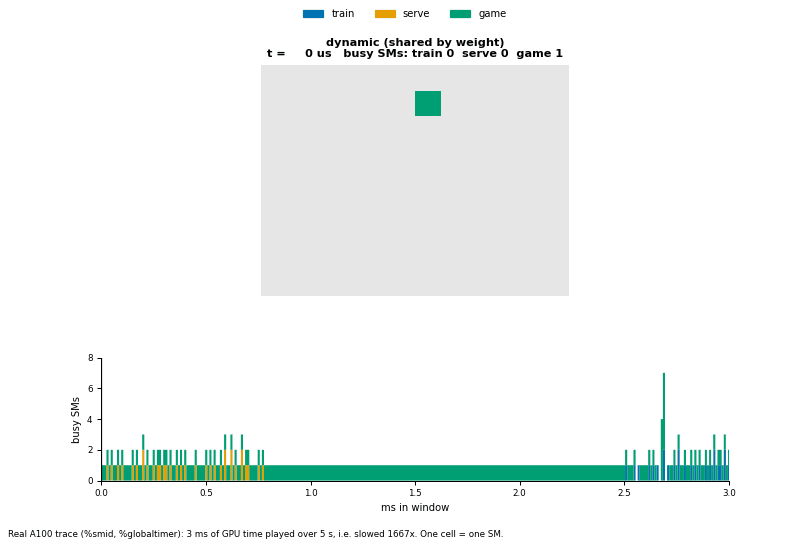
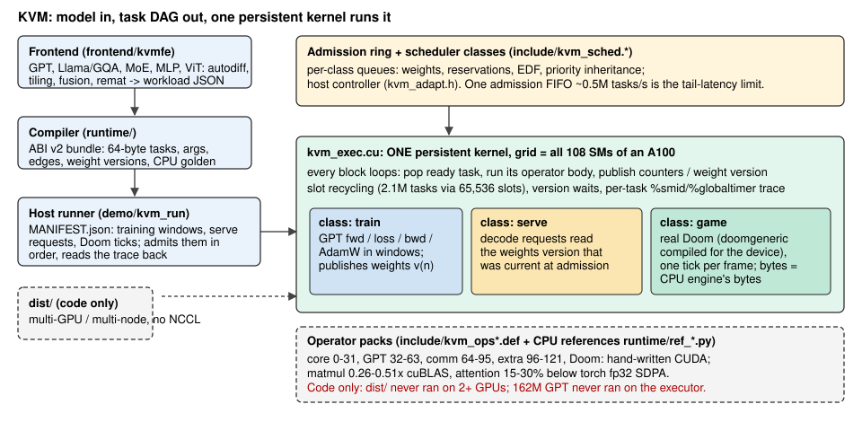
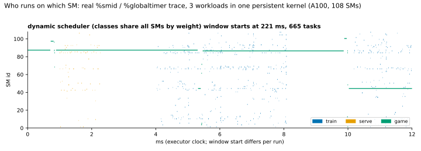
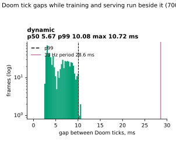
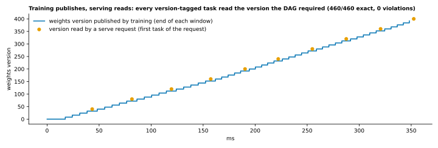
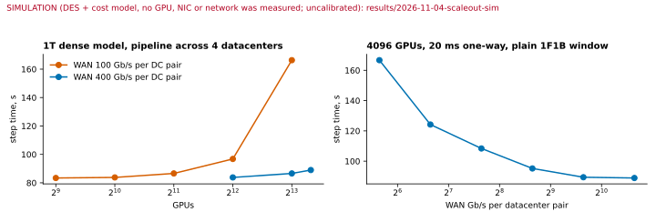

# KVM: a "kittens" GPU virtual machine

One persistent CUDA kernel takes over every SM of the GPU and interprets a task DAG itself, so GPT training, GPT serving on the weights training just
published, and real Doom run **in one kernel launch** with no kernel boundaries between ops, steps or workloads. A model description goes in
(`frontend/kvmfe`), a bundle of tasks comes out (`runtime/`), a generic executor runs it (`kvm_exec.cu`), and each task logs which SM ran it and when.
Version 2 of [open-flapping-airplanes](https://github.com/Bobliuuu/open-flapping-airplanes); an attempt to reproduce the capability Flapping Airplanes
describes for their "kittens" VM (they publish no code or numbers; not affiliated).

**Honest in one paragraph.** It runs and it is checked: the Doom frames equal the CPU engine's bytes, the loss tracks a CPU golden to 4e-6, served tokens equal a
golden decode of the weights version they read. It is not fast: a whole-step CUDA graph beats it 3.9-5.4x on small models, its hand-written ops reach 0.26-0.51x of
cuBLAS, and nothing has run on more than one GPU. The one place it beats the conventional stack is the `kvm.cu` prototype's small MLP (1.50x over its best baseline,
1 run). Details: [claims audit](results/2026-11-04-claims-audit/README.md) and the tables below.



*Real A100 trace (`%smid`, `%globaltimer`), a few ms slowed down: train, serve and Doom tasks landing on SMs under the dynamic scheduler (left) and a fixed 70/10/20 split
(right). Double-click [`demo/index.html`](demo/index.html) for the interactive version with all charts (no network needed).*

## Architecture



## What runs (A100-SXM4-40GB; each row names the result that measured it)

| Piece | Status | Evidence |
|---|---|---|
| One launch: training + serving + Doom (`demo/run_demo.sh`) | **Runs, all checks pass** (tiny GPT, 200 AdamW steps, 700 frames) | `results/2026-11-05-showcase` |
| Doom frames vs CPU engine | **700/700 byte-identical**; every recorded run frame-exact | `results/2026-11-03-a100-doom`, `results/2026-11-05-showcase` |
| Training vs CPU golden | loss within 2e-3 tolerance (measured 3.8e-6 on this model); GPT golden gap is 1xTF32 noise through AdamW | `results/2026-11-04-a100-gpt-golden` |
| Executor (admission, slot recycling, version waits) | **8582 checks, 0 failed**; 2.1M-task DAG via 65,536 slots; sanitizers clean; dispatch 1.38 us/task, dependent hop 7.0 us | `results/2026-11-04-a100-exec-recycling` |
| Scheduler (shares, reservations, EDF, inheritance) | Works. Beats static splits and flat queues under overload; **1.7-1.8x worse serve p99 than a plain priority queue**; the adaptive controller did not beat a hand-set priority | `results/2026-11-04-a100-sched-integrated`, `-adaptive` |
| Operator packs (GPT, extra, 24-model zoo vs golden) | Correct. **Matmul 0.26-0.51x cuBLAS**, attention 15-30% below torch fp32 SDPA | `results/2026-11-04-a100-ops-perf`, `-models` |
| VM vs conventional execution | `kvm.cu` MLP **wins 1.50x** (1 run) / 1.13x (32 runs). Executor vs whole-step CUDA graph: **loses 3.9-5.4x** (claims audit, small MLP / 3-layer transformer) | README results table, `results/2026-11-04-claims-audit` |
| Scale-out (partitioner, no NCCL, 1T plan) | **Simulation and code only.** 14 stages pass on one GPU, 4 skip; nothing ran on 2+ GPUs, NVLink or a network | `results/2026-11-03-dist-singlebox`, `results/2026-11-04-scaleout-sim` |
| Not built | device-side preemption, dynamic shapes, real bf16 storage, TMA/wgmma/tcgen05 | AGENTS.md |

## Quickstart

From a clean clone, no GPU, about a minute:

```bash
git clone https://github.com/Bobliuuu/kvm && cd kvm
python3 -I -m unittest discover -s tests              # 145 CPU tests, ~10 s: compiler, ABI v2, CPU VM, GPT reference
python3 -I -m unittest discover -s tests/frontend     # 59 tests, ~2 min: autodiff vs finite differences, golden models
pip install matplotlib numpy pillow                   # plus ffmpeg on PATH
demo/viz/make_all.sh                                  # regenerate every chart, the GIF and demo/index.html from the committed traces
open demo/index.html                                  # or double-click it (xdg-open on Linux)
```

With a GPU box (CUDA 12, sm_80+, `rsync`, `flock`; hosts and keys come from the environment only, see [RUNNING_TESTS.md](RUNNING_TESTS.md)):

```bash
KVM_HOST=user@host demo/run_demo.sh tiny              # build, run, check: loss vs golden, versions, Doom vs CPU oracle, cadence
KVM_HOST=user@host demo/viz/collect.sh                # the same demo under dynamic, static and global schedulers (+ frames)
demo/viz/make_all.sh --package                        # copy those runs into results/2026-11-05-showcase and rebuild all assets + the video
```

Or on the GPU box itself, `kvm.cu` alone: `nvcc -O3 -arch=sm_80 -std=c++17 -DKTILE=32 -DKKC=64 -DKSTG=4 kvm.cu -o kvm && ./kvm --selftest && ./kvm --runs 8 --steps 300`.

## Gallery (all generated by `demo/viz/` from real run data; the scale-out chart is a simulation and says so)

| | |
|---|---|
|  | Which SM ran which task (train / serve / Doom), dynamic vs static split: `sm_timeline.svg`, `sm_occupancy.svg` |
|  | Gap between Doom ticks per scheduler (`doom_frame_gaps.svg`) |
|  | Training publishes weight versions, serve requests read them (`weight_versions.svg`, `loss_tokens.svg`) |
|  | Scale-out cost model, **simulated** (`scaleout.svg`); honest scoreboard in `scoreboard.svg` |

Video (2.4 MB, [`demo/assets/doom_demo.mp4`](demo/assets/doom_demo.mp4)): the 700 real Doom frames the GPU produced next to the training loss and served tokens
from the same run; every frame is compared (sha256) with the CPU oracle inside the video. Regenerate with `demo/viz/make_all.sh`.

**Not shown / limits.** The committed run data is a single scheduler (dynamic) from an earlier tree (see `results/2026-11-05-showcase/README.md`) unless that README says
otherwise; charts comparing schedulers only appear for modes that have data. Training finishes in the first 0.35 s of the 4.2 s run, so the loss curve and Doom run
side by side only at the start. The GPU is mostly idle in this demo. Doom is not frame-paced here (it free-runs), so the gap histogram shows spacing under co-tenancy, not a 35 Hz proof.


## The integrated framework

```
 frontend/kvmfe  model config -> autodiff -> tiles -> dataflow edges     FRONTEND.md
        |  workload JSON
 runtime/compile_workload.py   ABI v2 bundle (tasks, edges, args, versions) + CPU golden     FRAMEWORK.md
        |  bundle
 kvm_exec.cu / kvm_exec.cuh    persistent kernel: admission ring, slot recycling, ready rings, version waits
   + kvm_sched.*               per-workload scheduler (reservations, weights, EDF, inheritance, bandwidth arbiter), host controller kvm_adapt.h
   + operator registry packs   kvm_ops.def (core, ids 0-31), kvm_ops_gpt (32-63), kvm_ops_comm (64-95), kvm_ops_extra (96-121), kvm_ops_game (Doom)
   + dist/, runtime/partition.py   multi-GPU / multi-node code without NCCL                  DISTRIBUTED.md
```

| Part | Where |
|---|---|
| ABI v2 (64-byte task descriptor, typed args, weight versions) | `include/kvm_task_abi.h`, `runtime/abi.py`, FRAMEWORK.md |
| Operator registry packs (one `.def` per pack, sparse unique ids) | `include/kvm_ops*.def`, `.cuh` bodies, CPU references `runtime/ref_*.py` |
| Executor (dynamic admission, slot recycling, streaming, litmus-tested ordering) | `kvm_exec.cu`, `include/kvm_exec.cuh`, `results/2026-11-03-a100-exec`, `results/2026-11-04-a100-exec-recycling` |
| Scheduler and adaptive controller | `include/kvm_sched.*`, `include/kvm_adapt.h`, `adaptive/`, `results/2026-11-03-a100-sched`, `results/2026-11-04-a100-sched-integrated`, `results/2026-11-04-a100-adaptive` |
| Frontend and model zoo (GPT, Llama/GQA, MoE, MLP, ViT, bf16, fusion, remat) | `frontend/kvmfe`, FRONTEND.md, `results/2026-11-04-a100-models` |
| Real Doom (doomgeneric compiled for the device) | `doom/`, `results/2026-11-03-a100-doom` |
| Multi-GPU code | `dist/`, `runtime/partition.py`, DISTRIBUTED.md, `results/2026-11-03-dist-singlebox` |

### Status (A100-SXM4-40GB unless stated; each row cites the result that measured it)

| Status | What |
|---|---|
| **Implemented and measured** | `kvm.cu` MLP training: 1.50x over the best baseline at 1 run, 1.13x at 32 (table below; predates the loop opcode). |
| | Executor: 8582 checks, 0 failed, in two recorded runs (`2026-11-04-a100-sched-integrated`, `2026-11-04-a100-ops-perf`); 2.1M-task DAG through 65,536 slots; both negative builds detected; sanitizers clean; litmus 15 properties pass, 7 mutants detected. Dispatch 1.38 us/task at 108 blocks, dependent hop 7.0 us (`2026-11-04-a100-exec-recycling`). |
| | Scheduler: weighted shares, reservations, EDF, priority inheritance, overload isolation (train 8-11x better than a priority queue under a serve flood) (`2026-11-03-a100-sched`, `2026-11-04-a100-sched-integrated`). |
| | Real Doom: every frame equals the CPU oracle in all recorded runs (2000 standalone, 700 per executor scenario, 12/12 scheduler scenarios, 162 adaptive runs with up to 8 instances); 35 Hz held beside a saturating load under the dynamic scheduler (0 of 698 gaps over 28.57 ms). |
| | GPT/extra op packs: `test_ops` 1396 and `test_extra` 2089 checks in the recorded round-2 run, sanitizers clean (`2026-11-04-a100-ops-perf`); 2-layer GQA GPT, 200 AdamW steps vs a double CPU model, loss gap 2.0e-4 (`2026-11-03-a100-gptops`). |
| | Model zoo: 24 bundles (5 families, bf16, fusion, remat, accumulation, LR schedule) match the CPU golden within the stated per-mode tolerances; 24 sanitizer runs clean (`2026-11-04-a100-models`). GPT golden mismatch is 1xTF32 gradient noise through AdamW, not a bug (`2026-11-04-a100-gpt-golden`). |
| | Multi-GPU code on ONE GPU: 14 stages pass, 4 skipped (`2026-11-03-dist-singlebox`). |
| **Code only (no result measures the claim)** | Multi-GPU and multi-node execution (needs 2+ GPUs / hosts; the stages SKIP). RDMA transport is a stub. 162M-parameter GPT: compiled and inspected, never executed on the executor. The 1T-parameter section of DISTRIBUTED.md is arithmetic. Affinity hint (implemented, tested, no benefit measured, off by default). bf16 matmul tile speed (correct, speed not benchmarked). |
| **Not built** | Class-aware or sliced admission (the single admission FIFO is the tail-latency limit, below). Device-side task yield/preemption. Dynamic shapes, data-dependent control flow. Real bf16/fp16 storage (bf16 is emulated in fp32 buffers). Hopper/Blackwell paths (TMA, wgmma, tcgen05). A rendered timeline figure from the executor's traces. A comparison of the executor against PyTorch eager / CUDA graphs / `torch.compile` on the same model (no result has one, so "faster than the conventional stack" is shown only for the `kvm.cu` MLP). |

### Known failures and honest negatives

| Item | State | Evidence |
|---|---|---|
| `recycle` long-running admission flake | 3M tasks through 4096 slots failed 2 of 3 runs on the adaptive tree (producers gave up after the 60 s window wait); the base commit shows the same flake; passes in 6.2-6.3 s otherwise. Not root-caused; scheduler off in that test. | `2026-11-04-a100-adaptive` failure list 1 |
| `test_ops` T=1 attention-backward tolerance | At T=1, dq and dk are exactly 0 mathematically and only rounding noise remains, so the bound is absolute (`tests/gpu_ops/test_ops.cu`, line 264). A failure of this case was reported against the integrated tree; no result README records it. Treat as open. | code comment only |
| Matmul at about 0.5x cuBLAS | Best 51.0 TFLOP/s (256x128 tile) against cuBLAS TF32 105.6 at 4096^3 (0.48x); 0.34-0.51x on other shapes. The 70% target was not reached. Attention is 15-30% below torch fp32 SDPA. | `2026-11-04-a100-ops-perf` |
| No multi-GPU hardware run | Nothing ran on more than one GPU, NVLink, or a network. | `2026-11-03-dist-singlebox` |
| Bandwidth arbiter | No latency win: 7% p99 in a synthetic chain; none with real Doom/serve tenants (they are not bandwidth-sensitive). It is a throttle that trades stream throughput for little latency. | `2026-11-03-a100-sched`, `2026-11-04-a100-adaptive` |
| Admission FIFO tail latency | The admitter ingests one record at a time at 1.9 us/task (0.52M tasks/s): a latency bundle waits for all K tasks ahead of it. A 47k-task training record puts every Doom frame behind 100-300 ms; no policy fixes it, host-side per-class budgets help at the price of shedding load (38% of serve requests dropped in the tuned run). | `2026-11-04-a100-adaptive` |
| Adaptive controller | Did not beat a hand-set fixed priority configuration (Doom frames late 470 vs 353 of 4030; serve p99 70.7 vs 60.8 ms). Its value is robustness (starvation floor, fast attack), not better numbers. | `2026-11-04-a100-adaptive` |
| Dynamic scheduler vs plain priority | Serve p99 1.7-1.8x worse than a global queue giving serve a higher priority, at equal throughput; adds 3-4 us per task dispatch. Wins only against static splits and under overload. | `2026-11-04-a100-sched-integrated` |
| Dispatch ceiling | About 0.7M tasks/s; the GPT-pack kernel uses 255 registers, so 1 block per SM (grid 108). Tasks under about 100 us per CTA are dispatch-bound. | `2026-11-04-a100-exec-recycling`, `2026-11-04-a100-ops-perf` |
| RTX 5070 Laptop (sm_120) | `kvm.cu` passes but never clearly beats the batched graph (0.73-1.12x). | `2026-11-03-rtx5070-laptop-sm120` |

Tests and how to run them: [RUNNING_TESTS.md](RUNNING_TESTS.md). Quick check without a GPU:
`python3 -I -m unittest discover -s tests && python3 -I -m unittest discover -s tests/frontend`.

## The `kvm.cu` prototype

`kvm.cu` is a self-contained prototype (CUDA, sm_80, one file). The numbers below predate its loop opcode: rerun before quoting.

## How it works

- **Tape**: 80-byte instructions (`GEMM` tile with epilogue flags, `SGD`). Tile GEMM is TF32 `wmma`
  with a `cp.async` smem ring; epilogues fuse ReLU, ReLU-mask, MSE loss/gradient and in-place SGD.
- **Scheduling**: persistent grid (SMs x occupancy). Blocks claim the next tape entry with one
  `atomicAdd`; the tape is topologically ordered, so waiting never deadlocks.
- **Dependencies**: monotonic global counters (never reset), per-row-block where possible
  (`H1[rb]` -> `Y[rb]` -> `dH1[rb]`) so step s+1 can start before step s is fully finished.
  No grid barriers.
- **Multi-run**: `--runs R` interleaves R independent training runs (an LR sweep) in one tape; the VM
  fills the GPU with whichever run's tiles are ready.
- **Baselines** run the *same tape* the classic way: one launch per op-phase (sequential, one model at a
  time), the same launches in a CUDA graph per run, and "batched" (one launch per phase for all runs,
  vmap-like, captured in a graph).

## Build / run

```bash
nvcc -O3 -arch=sm_80 -std=c++17 -DKTILE=32 -DKKC=64 -DKSTG=4 kvm.cu -o kvm
./kvm --selftest                       # GEMM, all 4 transpose combos vs CPU
./kvm --runs 8 --steps 300             # 8 fused LR-sweep runs vs baselines
```

Options: `--reps N` (timed passes), `--modes seq,seqgraph,batched,claim,queue`, `--watchdog-ms` (every VM spin is bounded; a
stuck run ends in `FAIL (watchdog)` with the blocked instruction or queue state), `--quiet`, `--inject-fault` (watchdog test).
`./run_gpu_queue_matrix.sh` runs the whole validation matrix on a GPU box.

Knobs: `-DKTILE` (32|64), `-DKKC` (K chunk, 32|64), `-DKSTG` (cp.async stages). Dims must be multiples
of max(KTILE, KKC). `run_remote.sh` rsyncs to a GPU box (`KVM_HOST`), builds and runs under `flock`.

## Results (A100-SXM4-40GB, MLP B=128 D=128 H=256 O=64, KTILE=32 KKC=64 KSTG=4)

Measured at 88c26a4 on a shared A100 (108 SMs, driver 580.105.08, nvcc 12.8); the full set, with raw output, is in
[results/2026-11-03-a100-queue](results/2026-11-03-a100-queue/README.md). Five modes run the same tape; `--modes` picks a subset.
Every run ends in `PASS`: final weights bitwise identical across the modes on every pass, loss within 4e-5 of CPU fp32.
Ratios are the median of 5-7 interleaved passes in one process, [min, max] over passes.

| runs | claim VM vs batched graph | ready queue vs batched graph | ready queue vs claim VM |
|---|---|---|---|
| 1  | 1.11x [1.10, 1.11] | 0.86x [0.86, 0.87] | 0.78x [0.77, 0.79] |
| 2  | 1.15x [1.14, 1.16] | 0.88x [0.88, 0.90] | 0.77x [0.76, 0.78] |
| 8  | 1.51x [1.51, 1.51] | 1.42x [1.41, 1.43] | 0.94x [0.94, 0.95] |
| 32 (100 steps) | 1.03x [1.03, 1.03] | 0.97x [0.97, 0.98] | 0.94x [0.94, 0.94] |

The ready queue (`queue`: dependencies of the whole tape lowered to a DAG on the host, successors released on the device) is
slower than claim-and-wait at every size: its dependency hop is about 6.6 us against 5.2 us. The earlier README numbers
(1.50x, 1.63x, 1.13x, measured at acb3bf4 before the loop opcode) are superseded.

## Findings / caveats

- A single small dense run is latency-bound: each dependent hop costs ~5 us (fence + counter + poll +
  first `cp.async` round trip + wmma chain), so the VM is only 1.11x over the best graph there (25.8 against 28.7 us per step).
- Fusing many runs is where the VM pays off most (1.51x at 8 runs); at 32 runs it is compute-bound (3.5 us/run-step) and the
  batched graph is within 3%.
- The GPU box is shared, so absolute numbers move run to run (baselines varied by up to ~1.5x between
  builds); ratios within one run are the meaningful figure.
- Tile GEMM is far from peak (TF32 wmma, 4 warps, ~10 TFLOPs at the largest size tried). Tape is
  host-generated (88 MB at 32 runs x 300 steps); a loop opcode would shrink it.
- Not done: on-chip weight residency across steps, bf16 path, transformer ops, H100 features
  (TMA/wgmma). That is what a real kittens VM would add.
