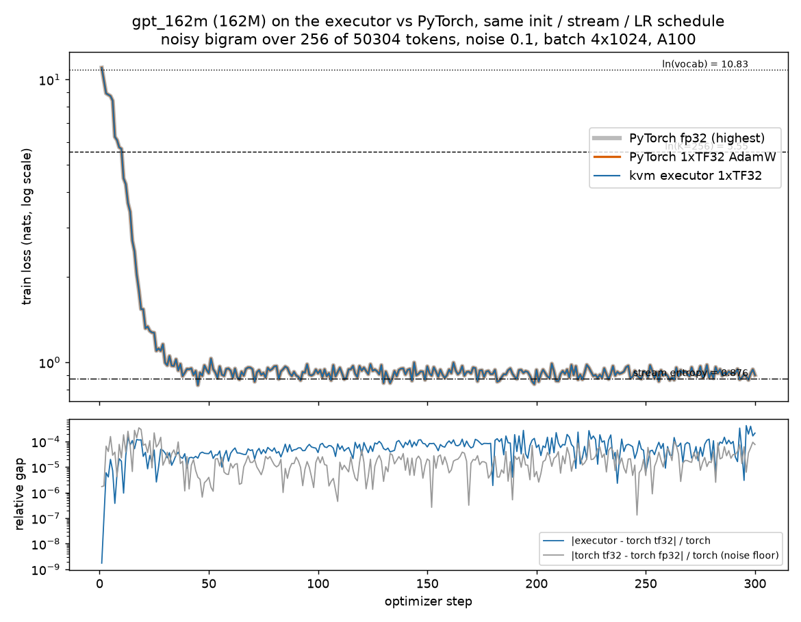

# gpt_162m learns on the executor, and tracks PyTorch to 4e-4 (300 steps)

The 162M GPT (12 layers, d768, 12 heads, seq 1024, batch 4, vocab 50304) trains on the executor, one `kvm_run` launch per step (window 1), and
its loss curve matches PyTorch's on the same init, token stream, AdamW, LR schedule and clip, at every step.

| | |
|---|---|
| GPU | NVIDIA A100-SXM4-80GB (Modal), 108 SMs, driver 610.57.04, nvcc 12.4 (executor build), torch 2.15.0+cu132 |
| Build | `nvcc -O3 -arch=sm_80 -std=c++17 -I. -Iinclude --fmad=false -Xcompiler -ffp-contract=off -lineinfo -diag-suppress 177 demo/kvm_run.cu` |
| Executor | 1xTF32 GEMMs (main), tiling a100, `--reuse shape`, 300 admissions of one step, 95,442,000 / 95,442,000 tasks OK, 389 s kernel time (395 s wall, 1.3 s/step) |
| Optimiser | AdamW lr 3e-4, 5 warmup steps then constant, betas (0.9, 0.95), wd 0.01 on matrices, clip 1.0 |
| Command | `modal run --detach tests/modal/run_gpt162.py --stage learn --tag learn256b --k 256 --noise 0.1 --steps 300 --lr 3e-4 --warmup 5` (runs `tests/gpt162/learning.sh`, then `learning_plot.py`) |
| Code | branch `results/learning-162m`; the run used 7cdd5b1-era code (stream option 106c304, driver fixes after); results added at the commit that adds this README |

## The stream

`ModelConfig.data_vocab=256, data_noise=0.1` (new, default off, unit-tested): the bigram t -> 5t+3 on the first 256 ids only; each successor is replaced by a
uniform draw from those 256 with probability 0.1 (seeded per step, so every step is a fresh batch and hold-out batches are unseen). Floors: ln(50304) = 10.83
(untrained), ln(256) = 5.55 (knows only the support), **exact stream entropy 0.876 nats** (best possible).

## Results (`loss.csv`, `curve.json`, `summary.json`)

| | executor | torch 1xTF32 | torch fp32 |
|---|---|---|---|
| step 1 loss | 11.0091 | 11.0091 | 11.0091 |
| first step below ln(256) | 11 | 11 | |
| first step within 0.1 of entropy | 31 | 31 | |
| mean of last 30 steps | 0.9140 | 0.9140 | 0.9140 |
| hold-out loss, 8 unseen batches (init 10.995) | 0.90838 | 0.90825 | 0.90829 |

Max relative per-step gap executor vs torch-tf32: **4.2e-4** (step 296; median 5.7e-5, mean 6.8e-5, never over 1e-3). The torch tf32 vs torch fp32 noise floor is
3.5e-4, so the executor is inside torch's own precision noise. The curve stays on the entropy floor (about 0.91, 0.04 above it from batch noise) to step 300: it learned the
bigram and the noise rate, and generalises (hold-out equals train). No divergence step exists to bisect.

## Honest limits

- 300 steps x 4096 tokens: the model learns a 256-token bigram, not language. It shows the gradients and optimiser at 162M are right end to end, which six steps on the full-vocab stream could not.
- bf16s (branch perf/combined or perf/bf16-a100) curve: not run.
- Executor speed here is 1.3 s/step (admission bound, see `2026-11-06-demo-large`); torch is about 0.06 s/step.
- First Modal attempt exit 127 (`/usr/bin/time` missing in the container); fixed, rerun is this result.

## Files

`learn.log` (full log), `curve.log`, `curve.json` (executor/torch curves, hold-out), `loss.csv`, `loss.png`, `summary.json`, `exec_observations.jsonl`, `exec_run.json`,
`exec_kvm_run.log`, `nvidia.txt`, `model.json`.

## Proposed text for README.md (not applied)

"The 162M GPT trains on the executor: on a 256-token noisy-bigram stream the loss falls from 11.01 to the stream entropy (0.88) within 31 steps, tracking PyTorch (tf32 AdamW) to a max
relative gap of 4.2e-4 over 300 steps, hold-out loss 0.908 vs torch 0.908 (`results/2026-11-06-a100-learning-162m`)."
