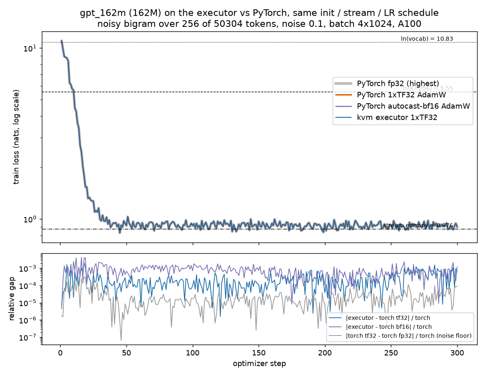

# gpt_162m learns in real bf16 storage (bf16s) and tracks PyTorch autocast-bf16 (300 steps)

The bf16s twin of `results/2026-11-06-a100-learning-162m` (f32). Same model, init, token stream, AdamW, LR schedule and clip; the model runs with
`precision: "bf16s"` (bf16 activations in 2-byte buffers, bf16 tensor-core GEMM tiles, fp32 master weights, gradients and AdamW state). One `kvm_run`
launch, 300 admissions of one step each (window 1).

| | |
|---|---|
| GPU | NVIDIA A100-SXM4-40GB (Modal), 108 SMs, driver 610.57.04; `kvm_run` built with nvcc 12.4; torch 2.15.0+cu132 |
| Build | `nvcc -O3 -arch=sm_80 -std=c++17 -I. -Iinclude --fmad=false -Xcompiler -ffp-contract=off -lineinfo -diag-suppress 177 demo/kvm_run.cu` |
| Code | main at `bdda80d` (executor, ops and frontend), plus the test tools of this branch (`tests/gpt162/*`, `tests/modal/run_gpt162.py`: bf16 torch curve, `--prec`, `--bin-dir`, `--gpu40`) |
| Command | `modal run --detach tests/modal/run_gpt162.py --stage build --bin-dir BIN-main-bdda80d`, then `--stage learn --tag learn-bf16s-main-bdda80d --prec bf16s --bin-dir BIN-main-bdda80d --gpu40 --k 256 --noise 0.1 --steps 300 --lr 3e-4 --warmup 5` |
| Model | `model.json`: gpt_162m (12 layers, d768, 12 heads, seq 1024, batch 4, vocab 50304), 256-token noisy bigram stream (`data_vocab 256`, `data_noise 0.1`, exact entropy 0.876 nats) |
| Executor | 17,590,500 / 17,590,500 tasks OK, 85.6 s kernel time (98 s wall): **0.285 s/step** |

## Results (`summary.json`, `curve.json`, `curve.log`)

| | executor bf16s | torch autocast-bf16 | torch 1xTF32 | torch fp32 |
|---|---|---|---|---|
| step 1 loss | 11.00904 | 11.00899 | 11.00912 | 11.00913 |
| first step below ln(256) | 11 | 11 | 11 | |
| first step within 0.1 of the entropy | 31 | 33 | 31 | |
| mean of last 30 steps | 0.91364 | 0.91371 | 0.91395 | 0.91395 |
| hold-out loss, 8 unseen batches (init 10.995) | 0.90923 | 0.90849 | 0.90825 | 0.90829 |

Gaps per step (relative, `summary.json`):

| | max | median |
|---|---|---|
| executor bf16s vs torch autocast-bf16 | 4.3e-3 (step 16) | 7.0e-4 |
| executor bf16s vs torch tf32 | 2.0e-3 (step 18) | 1.7e-4 |
| torch autocast-bf16 vs torch tf32 (the bf16 noise floor) | 6.0e-3 (step 18) | 8.0e-4 |

Absolute (`curve.log`): executor - torch bf16 max 0.017, torch bf16 - torch tf32 max 0.026. The executor's bf16s curve lies inside the spread between
torch's own bf16 and tf32 runs at every step; it reaches the entropy floor and generalises (hold-out equals train), like the f32 run.

## Honest limits

- The executor's rounding points are not torch autocast's: bf16s keeps the residual stream and layer-norm outputs in bf16, autocast keeps them in fp32. The two
  bf16 curves therefore differ by more than tf32 vs fp32 do (median 7e-4 vs 2e-4), and are compared against torch's own bf16-vs-tf32 spread, not against zero.
- A 256-token bigram, not language (same limit as the f32 run).
- Step time is not comparable to the f32 record directly: that run used older executor code on an A100-80GB (1.3 s/step). Both precisions on the same tree
  and GPU are not measured here.
- This branch's storage changes (`results/2026-11-10-a100-bf16-attention-storage`) were NOT in this run: its own curve was queued when all Modal work was
  stopped (its `kvm_run` is built, `BIN-bf16-78239dc` in the `kvm-gpt162` volume); the step-1 gradient check of bf16s (`--stage grads --prec bf16s`) was not run either.
- `main` before `bdda80d` could not run bf16s at all: `kvm_exec.cu` rejected dtype 2 buffers ("bad buffer shape or dtype"); #10/#17/#18 restored it.

## Files

`learn.log` (full log), `curve.log`, `curve.json` (executor, torch tf32 / fp32 / autocast-bf16 curves, hold-out), `loss.csv` (executor, tf32, fp32), `loss.png`,
`summary.json`, `exec_observations.jsonl`, `exec_run.json`, `exec_kvm_run.log`, `exec_wall.txt`, `nvidia.txt`, `model.json`.
